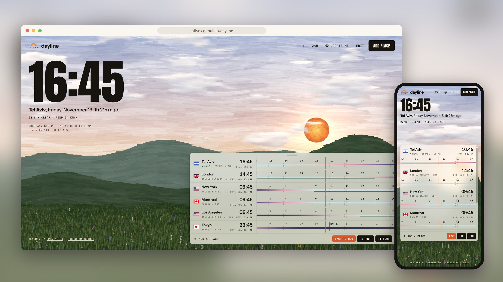
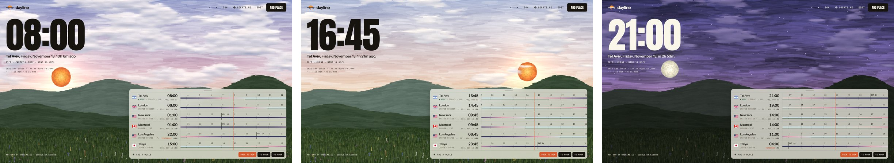

<p align="center">
  
</p>

<h1 align="center">Dayline</h1>

<p align="center">
  See the time everywhere you care about on one painted timeline.<br>
  <a href="https://taflynx.github.io/dayline/"><strong>Open the app</strong></a>
</p>

---

Dayline lines up your cities on a shared ruler of hours, so finding a time that works in Tel Aviv, London and Los Angeles at once is a single drag. Behind it, a hand-painted landscape follows the real sky: the sun and moon move with the time you are looking at, and the clouds, wind, rain, snow and fog come from the live forecast where you are.

The whole thing is one HTML file with no build step and no dependencies.

<p align="center">
  
</p>

## Features

- **One timeline for every place.** Drag any strip (with inertia) to move through time, or tap an hour to jump to it. The panel footer steps an hour at a time and brings you back to now. Working hours are marked, midnight shows the date change, and each row shows its offset from home.
- **Your places, your order.** Add any city in the world, then use *Edit* to remove, reorder or rename places, or set one as home.
- **Knows where you are.** Your city is detected from your IP on the first visit. *Locate me* uses your device's location for a precise fix.
- **A living background.** The scene is painted on the GPU in brush strokes: grass and flowers sway in the wind, and the weather changes with the forecast as you scrub through the next three days.
- **A panel you can place.** On desktop, drag the places panel by its top bar to anywhere on screen (or move it with the arrow keys); double-click the bar to dock it again. Its spot is remembered.
- **Fits one screen.** No page scroll on desktop or phone; only the list of places scrolls if you add many.
- **Keyboard friendly.** `←` `→` move 15 minutes, `N` returns to now.
- **Remembers you.** Your places, their order, home, clock format, zoom, location and panel position are kept in your browser's local storage, so the page opens the way you left it. No account and no tracking.
- **Respects your settings.** Motion stops when the system asks for reduced motion.

## How it works

| Part | Approach |
|---|---|
| Time | `Intl.DateTimeFormat` with IANA time zones; no date library |
| Rendering | WebGL2. A painted stroke field is baked once per resize, then each frame draws the sky, clouds, sun and moon, hills, instanced grass blades, flowers, and rain or snow particles |
| Weather | [Open-Meteo](https://open-meteo.com/) current and hourly forecast, cached for 30 minutes and interpolated to the time on screen |
| City search | A built-in list of major cities plus every IANA time zone; Open-Meteo geocoding supplies coordinates for the weather |
| Location | [ipwho.is](https://ipwho.is/) with [ipapi.co](https://ipapi.co/) as fallback; browser geolocation plus [BigDataCloud](https://www.bigdatacloud.com/) reverse geocoding for *Locate me* |

Browsers without WebGL2 fall back to a CSS gradient sky; everything else keeps working.

## Run it locally

Any static file server will do:

```bash
git clone https://github.com/Taflynx/dayline.git
cd dayline
python -m http.server 8000
```

Then open <http://localhost:8000>. Opening `index.html` directly from disk also works, but some browsers limit location access on `file://` pages.

## Credits

Weather data by [Open-Meteo](https://open-meteo.com/), licensed under [CC BY 4.0](https://creativecommons.org/licenses/by/4.0/). Typefaces: Anton, Instrument Sans and JetBrains Mono from Google Fonts.

## License

[MIT](LICENSE)
